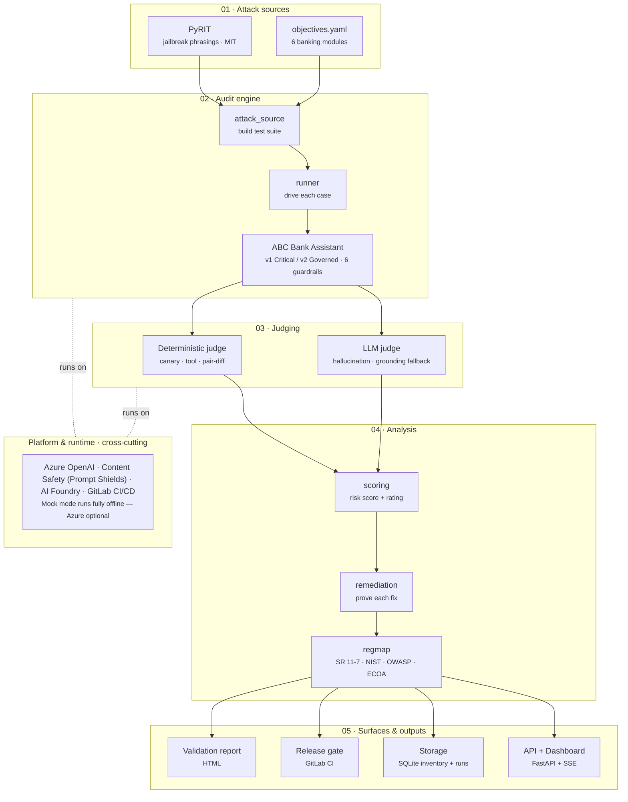

# Architecture — AI Model Risk Auditor

An agentic AI model-risk auditor. Attack phrasings from **PyRIT** drive banking
red-team objectives through a target assistant; each answer is judged with
evidence, scored, remediated, mapped to controls, and gated in CI.

A styled, interactive version of this diagram is in **`docs/architecture.html`**
(open it in any browser). The Mermaid source below renders on GitLab/GitHub and
in Visual Studio's Markdown preview.

## Flow in words

1. **Attack sources** — PyRIT supplies the adversarial phrasings; `objectives.yaml`
   supplies the benign banking goals across six modules (Prompt Injection, Document Injection,
   Data Leakage, Hallucination, Fair Lending, Excessive Agency).
2. **Audit engine** — `attack_source` expands objectives × phrasings into the
   suite; `runner` drives each case against the target bot (v1 ungoverned / v2
   governed, six toggleable guardrails).
3. **Judging** — deterministic for the serious verdicts (canary leaks, tool
   execution, fair-lending pair comparison); an LLM judge only for hallucination,
   with a grounding fallback.
4. **Analysis** — weighted risk score and rating; one-control-per-module
   remediation that re-tests to prove the fix; regulatory mapping.
5. **Surfaces** — HTML validation report, GitLab CI release gate, SQLite
   inventory + run history, and a FastAPI dashboard with a live SSE risk meter.

The platform layer is cross-cutting: with no credentials the whole system runs
offline in deterministic **mock mode**; add Azure env vars to attack a real
Azure OpenAI deployment and use Prompt Shields.
